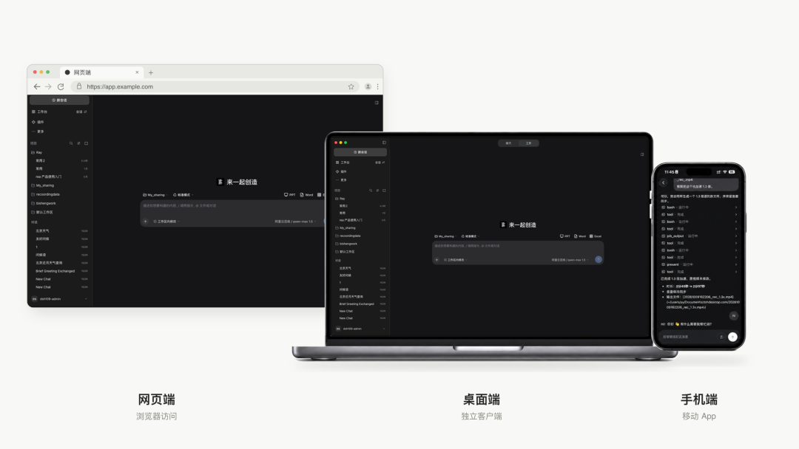

<h1 align="center">
  
</h1>

  <strong>BISHENG Desktop es un Agent de escritorio que conecta el trabajo local con la IA empresarial.</strong> 
  Los empleados acceden con su cuenta empresarial a los modelos, bases de conocimiento, herramientas y habilidades autorizados. Chat ofrece consultas y tareas de varios pasos en la nube, mientras Work procesa materiales locales en directorios autorizados. La empresa administra recursos, permisos, créditos y uso de forma centralizada. 
  <a href="https://dshdesktop.com/zh/enterprise/">Descargar BISHENG Desktop</a> · <a href="https://github.com/dataelement/bisheng">Repositorio del servidor BISHENG</a>

  <a href="README.md">English</a> · <a href="README.zh.md">简体中文</a> · <a href="README.ja.md">日本語</a> · <a href="README.ru.md">Русский</a> · <a href="README.es.md">Español</a> · <a href="README.pt.md">Português</a>

  
  
  

## Qué puede hacer BISHENG Desktop

- **Chat: delega tareas en la nube empresarial.** Haz preguntas sobre tus materiales o usa el modo de tareas para ejecutar procesos de varios pasos, invocar habilidades y generar archivos, consultando el progreso y los resultados.
- **Work: trabaja de forma continua con materiales locales.** Selecciona un directorio autorizado para organizar materiales, analizar datos y generar archivos editables de Word, Excel y PPT. Sigue modificándolos según tus indicaciones y guarda los resultados en el directorio permitido.
- **Recursos empresariales según los permisos.** Usa tu cuenta empresarial para acceder a modelos, espacios de conocimiento, herramientas API/MCP y habilidades autorizados, y abre aplicaciones, asistentes y flujos de trabajo publicados en el centro de aplicaciones.
- **Administración empresarial centralizada.** Los administradores configuran recursos y permisos, distribuyen plugins y espacios de trabajo especializados, y gestionan créditos mensuales y uso de las llamadas. Las llamadas a modelos empresariales de Chat y Work comparten el registro de créditos del usuario actual.
- **Colaboración entre web y escritorio.** Cuando la misma cuenta empresarial abre la misma tarea del servidor en Chat web y de escritorio, puede consultar los eventos y el estado de finalización sincronizados. Las tareas locales de Work y sus resultados se gestionan en registros independientes.

> La aplicación móvil estará disponible próximamente; sus funciones y calendario dependen de la documentación de cada versión. Las capacidades de integración empresarial, los requisitos de despliegue y el alcance de las ediciones de código abierto y empresarial también dependen de dicha documentación.

## Plataforma BISHENG y proyectos relacionados

**BISHENG es una plataforma Agent empresarial integral y de código abierto**, centrada en la productividad de oficina y la adopción de IA empresarial. Proporciona al cliente modelos, conocimiento, herramientas, habilidades, aplicaciones y administración centralizada.

- [Plataforma empresarial BISHENG](https://github.com/dataelement/bisheng): despliega servicios de IA empresarial y administra los recursos, permisos y uso de la organización de forma centralizada.
- [DSH Desktop](https://github.com/dataelement/dsh-desktop): una base de Agent de escritorio de código abierto sobre DeepSeek Harness. BISHENG Desktop se apoya en ella para conectar servicios de IA empresarial.

## Descarga e instalación

Obtén el instalador en el [sitio de BISHENG Desktop](https://dshdesktop.com/zh/enterprise/) y úsalo con la plataforma BISHENG desplegada en tu empresa. Inicia sesión con tu cuenta empresarial para usar los recursos configurados y autorizados por el administrador.

Para usar la versión personal de forma independiente, visita el [sitio de DSH Desktop](https://dshdesktop.com/zh/).

## Archivos de oficina y funciones de escritorio

- **Entrega de archivos de oficina**: selecciona una plantilla en el modo PPT integrado, describe el contenido y genera un PPTX editable. El entorno de escritorio incluye Python y bibliotecas de Office para generar y comprobar DOCX, PPTX y XLSX. Consulta las plantillas y validaciones en la [guía de PPT](packages/ppt-runtime/README.md).
- **Espacios locales y configuración**: administra los espacios de trabajo con el selector de directorios del sistema. Los Profile, plugins, sesiones y ajustes de modelos se guardan fuera del directorio de instalación y se conservan al actualizar. Para importar y exportar configuraciones, consulta el [formato de paquetes Preset](docs/preset-packages.md).
- **Actualizaciones y recuperación**: las actualizaciones en línea aún no están habilitadas en las instalaciones actuales. Descarga un instalador nuevo en el [sitio oficial](https://dshdesktop.com/zh/enterprise/); la disponibilidad de las actualizaciones en línea depende de la documentación de la versión. Si falla un plugin, elige «Reiniciar en modo seguro…» en el menú `Harness` para desactivar temporalmente los plugins de terceros sin perder los datos del Profile normal. Los diagnósticos se escriben en `harness.log`. Consulta la [recuperación de plugins](docs/architecture.md#profiles-and-plugin-recovery) y las [actualizaciones](docs/architecture.md#updates).

## Conexión del teléfono y límites de los datos

El entorno de escritorio mantiene el emparejamiento del teléfono mediante QR: elige «Conectar teléfono…» en el menú `Harness` y escanea el código por WiFi. Un túnel de Internet también requiere la contraseña mostrada en el ordenador. De forma predeterminada caduca a los 5 minutos; solo se crea una contraseña duradera con consentimiento explícito. Al desconectar desde el escritorio, la sesión del teléfono deja de ser válida. Si la conexión falla, usa «¿No se abre el enlace QR? Probar otra ruta».

Este emparejamiento por navegador es independiente de la próxima aplicación móvil. Harness se ejecuta en un puerto loopback local aleatorio; el teléfono accede mediante un Bridge de emparejamiento independiente. Esto no sincroniza automáticamente las tareas de Work local y de la nube empresarial. Consulta los [límites del acceso móvil](docs/architecture.md#mobile-access-boundary).

El Renderer no tiene permisos de Node.js y utiliza Context Isolation y Sandbox. Las páginas externas se abren en el navegador del sistema. Los Profile y las sesiones se almacenan en el directorio de datos de aplicación del usuario. Consulta la [seguridad de ventanas e IPC](docs/architecture.md#window-and-ipc-security).

## Plataformas compatibles

| Plataforma | Distribución | Estado |
| --- | --- | --- |
| macOS Apple Silicon | DMG/ZIP firmados y notarizados | Compatible |
| macOS Intel | DMG/ZIP firmados y notarizados | Compatible |
| Windows x64 | Instalador NSIS con firma de código | Compatible |
| Windows ARM64 | — | No compatible actualmente |
| Linux | — | No compatible actualmente |

Harness incluye dependencias nativas de cada plataforma, por lo que los instaladores oficiales se compilan en el sistema operativo y la arquitectura correspondientes.

## Desarrollo y arquitectura

Las contribuciones son bienvenidas. La documentación técnica se organiza en:

- [Guía de desarrollo](docs/development.md) — entorno local, validación, mantenimiento de parches y empaquetado nativo
- [Arquitectura de ejecución](docs/architecture.md) — arranque, persistencia, seguridad, recuperación, teléfono y actualizaciones
- [Guía de publicación](docs/release-runbook.md) — firma y control de versiones oficiales
- [Formato de paquetes Preset](docs/preset-packages.md) — contrato de Agent Preset portátil

Antes de enviar cambios, ejecuta `npm test`, `npm run typecheck` y `npm run build`, y prueba los flujos afectados de la aplicación. No incluyas claves API reales en incidencias, registros, capturas o datos de prueba.

## Comunidad

Para hablar sobre la base de escritorio compartida, únete a la [comunidad DSH Desktop en Discord](https://discord.gg/7Xgf3qe3Qp) o escanea el QR del grupo de WeChat.

## Licencia

DSH Desktop es de código abierto bajo la [MIT License](LICENSE).

DeepSeek Harness y sus dependencias siguen sujetos a sus respectivas licencias y normas de marcas del proyecto original. DSH Desktop es una aplicación de escritorio comunitaria independiente.

## Empresas que usan BISHENG

BISHENG presta servicio a empresas líderes de diversos sectores. Estos son algunos de nuestros clientes.

## Consultas empresariales

Contacta con nosotros para conocer el despliegue empresarial de BISHENG, la integración del cliente de escritorio, demostraciones del producto o colaboraciones comerciales.

[Contactar con el equipo BISHENG mediante el formulario de Feishu](https://dataelem.feishu.cn/share/base/form/shrcnVow7GQwwKYEBCD41Bu5qoh)
