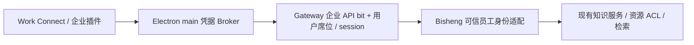

# BISHENG Work 企业知识库 Connect 方案

修订：2026-10-15。状态：已明确产品方向，尚未实现、部署或安装包验收。

本文替代 2026-10-09 草案中按共享容量、解析包和调用包收费的设计。[HTML 评审文档](design/bisheng-work-gateway-1.6.0.html) 聚焦加密、签名与认证主线；本文保留详细技术背景。

## 1. 已确认的三个原则

1. BISHENG Work 通过企业插件使用 Gateway 接口访问 Bisheng 知识库；业务不从桌面绕过 Gateway 直连。
2. Gateway 维护企业购买的知识 API 权限 bit；企业有 API 权限且当前用户已分配有效 Work 席位，开通知识库连接能力。
3. Work 以 Connect 方式管理企业知识库连接：企业登录、选择可见空间、在会话中启用检索并打开来源引用。

Bisheng 的基础知识库和既有开源 API 继续保留。商业授权面向 Work 的企业 API 接入，不改变开源知识能力的性质。本期不设计知识专用席位、共享容量售卖、检索调用计费或商业结算账本。

## 2. 架构与职责



- 企业插件：连接卡片、公开状态、空间选择、会话检索 tools 与引用展示。
- Electron main：保管和刷新凭据；固定操作白名单；取消旧账户请求。不向 renderer/模型暴露企业凭据。
- Gateway：每次业务调用验证企业 API bit、有效席位、session、API scope 与请求范围；传递可信员工身份并关联审计。
- Bisheng：按真实员工校验空间、目录、文件权限；执行检索和原有上传处理。企业购买不等于管理员数据权限。

同进程插件不是对抗本机管理员的安全沙箱。安全与商业准入在服务端执行，不能只靠 UI 隐藏。

## 3. 企业 API 权限 bit

建议名称 `WORK_KNOWLEDGE_API`，表示在 Work 中使用企业知识库 API 的权利。范围不扩大到所有普通 API。

- 企业购买权来自厂商签名 License 或可信商业控制面；普通企业管理员不能自行开启已购 bit。
- 管理员在已购范围内分配现有 Work 席位，不另建知识库席位池。
- bit 编号由 Gateway 注册域确认。新 `work_api_permission_bits` 域暂定 bit 0（mask=1）仅为设计，实施前检查占用与兼容。
- 旧 schema v2 没有 API bit：知识 API 默认关闭，原有基础席位与模型权限不自动改变。
- 客户端读取命名布尔投影，例如 `enterprise_api_enabled`，不自己解释原始 mask；避免 JavaScript 32 位运算截断。
- 新签名合同严格验证 issuer、audience、时间、部署/组织绑定和 revision；先升级 verifier，再发新 License。

```text
knowledge_connect_enabled = enterprise_api_bit_active
                         AND seat_assigned_to_current_user
                         AND seat_active
                         AND session_active

can_search = knowledge_connect_enabled AND scope.read AND Bisheng.read_acl
can_upload = knowledge_connect_enabled AND scope.upload AND Bisheng.write_acl
```

Gateway v1.6.0 内置基础 10 席位。沿用该基线时，已分配且有效的基础席位同样满足席位条件；企业仍须购买 API 权限。不得擅自增加“必须是扩容购买席位”的第三个条件。

API bit 有效期与席位有效性分别判断；撤权、到期和切企业后立即阻止后续业务调用，不能只等 access token 到期。

## 4. Connect 交互

路径：Connect → Bisheng 企业知识库 → 企业登录 → 校验 API bit 和席位 → 选择可访问空间 → 当前会话启用检索。

- 保持插件安装与入口可见；连接不可用时展示具体原因。
- 卡片展示企业、连接状态和已选空间；操作包括连接、管理连接与断开。
- 管理员统一配置企业 Gateway，用户不填写共享管理员 API key。
- 不同会话可以选择不同空间。已授权但未选空间时提示选择，不默认搜索全企业。
- `knowledge_search` 获取片段，Work 当前 Agent 生成答案；来源引用经 Gateway 重新鉴权。
- 可访问范围为：真实员工 ACL ∩ 当前会话启用空间 ∩ 本次请求空间。会话范围必须在服务端受约束，不能只写进 prompt。
- 断开、撤权、退出或切换企业后，取消在途请求、清理旧连接/范围并阻止旧响应。历史回答保留，来源访问重新检查。
- 不可用时不向 Agent 注册可执行的企业知识工具；已发出的调用仍由服务端最终拒绝。

本期先交付连接、检索和引用闭环。此前要求的上传保留为后续操作，使用同一 API bit + 席位授权，再额外判断目标写权限。

## 5. 状态与界面

| 状态 | 展示 | 行为 |
| --- | --- | --- |
| 未登录 | 未连接 | 登录企业，不判断是否购买 |
| 企业无 API bit | 企业未开通知识库 API | 联系管理员，不请求企业知识数据 |
| 企业有 API bit，员工无席位 | 尚未分配企业席位 | 申请席位或联系管理员 |
| 有 API bit 和席位，无资源权限 | 已连接，暂无可访问知识库 | 申请数据权限，不提示付费 |
| 已授权但未选空间 | 待选择知识库 | 选择本会话范围 |
| 已授权且选择空间 | 已连接，已选 N 个空间 | 检索与引用 |
| 只读权限 | 检索可用、上传不可用 | 说明缺少目标写权限 |
| API 权限到期或席位撤销 | 连接已停用 | 展示确切原因，不删除知识数据 |
| 网络或依赖异常 | 连接失败 | 重试，不误报未购买 |

## 6. 复用接口与鉴权缺口

本轮源码依据为 2026-10-15 本地 Bisheng main@3f2764198；正式部署版本另查。

- `GET /api/v2/filelib/`：知识资源列表。
- `GET /api/v2/filelib/file/list`：文件列表与状态筛选。
- `POST /api/v2/filelib/retrieve`：跨库纯检索，返回片段，不调用 LLM。
- `POST /api/v2/filelib/file/{knowledge_id}`：上传并提交处理。

列表、文件列表和检索支持 user_id 代用户过滤；该参数不是身份凭证。上传及引用详情仍以配置的默认操作员执行。企业接入必须补齐统一可信用户适配，不向所有员工共享管理员/default_operator。

Gateway 暴露受控 Work 知识接口，内部优先复用 Bisheng 服务层。旧 token audience 为模型接口，不能不改 verifier 就直接授予知识权限。保留 v1 与版本化 Work API 合同，按各自 audience/scope 校验。

上传的专属流式 route 必须排除 v1.6.0 的 CacheRequestBody 和统一正文缓存事件；保留实际字节限制、背压、幂等与异步 ready 状态。现有配额仅作为运行保护，不作为本期商业收费条件。

## 7. 首期实施与验收

1. 固定 Gateway v1.6.0 基准，确认权限位注册域和签名合同迁移。
2. 实现 API bit + seat/session 的统一准入与 capabilities 拒绝原因。
3. 补齐 Bisheng 可信员工身份适配，复用资源列表、纯检索和来源权限服务。
4. 接入 Connect 插件、空间选择、会话范围与 knowledge_search。
5. 验证真实企业登录 → Connect → 检索 → 来源预览；上传随后接入同一权限体系。

验收组合：API bit 0/1 × 席位 未分配/有效/撤销 × ACL 无/只读/可写。分别检查 UI、工具可用性、Gateway 实际拒绝与 Bisheng 数据过滤。增加伪造 user_id、跨企业空间、未选空间、注销/切企业、撤权/到期、多副本和旧模型 token 用例。安装包、真实企业和目标平台验收另行报告。
