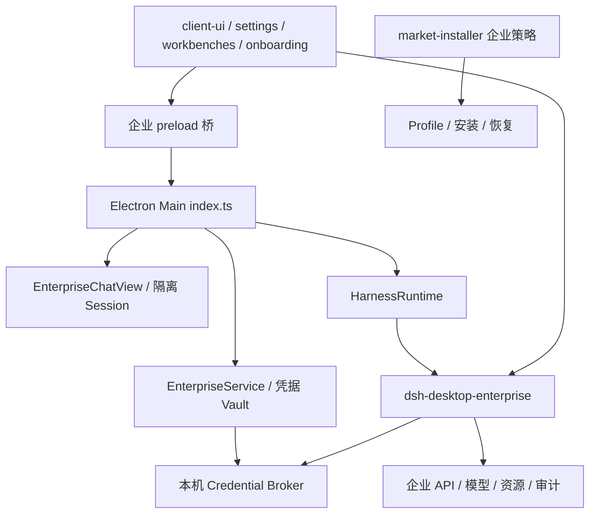
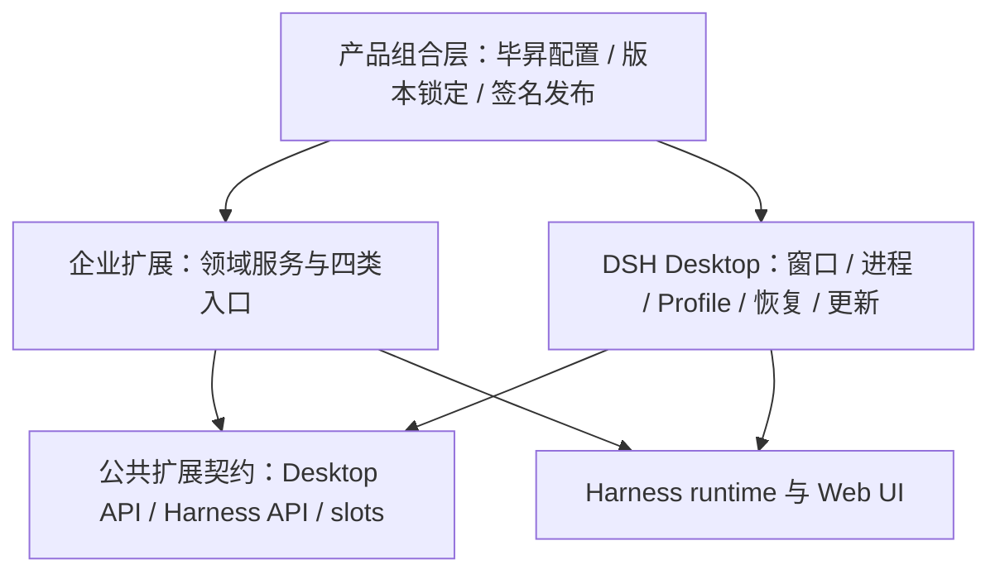
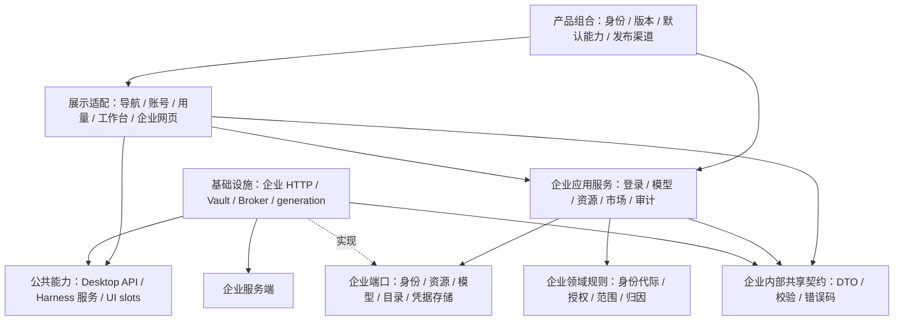

# 企业版与 DSH Desktop 底座解耦设计

- 状态：设计提案，尚未实现。
- 日期：2026-10-29。
- 代码基线：`e928c8c`。本文未确认远端 upstream 的最新状态。
- 写作方式：保留中文，采用 ASD-STE100 的简化技术写作原则；不声明符合该英语规范。

## 1. 目标与方案

企业功能在独立仓库维护。构建时，将企业扩展与固定版本的 DSH Desktop 组合成 Bisheng Desktop。

公共 DSH Desktop 必须能够独立构建、运行和发布。企业扩展通过公开接口使用底座能力。

采用两个 Git 仓库：

| 仓库 | 职责 |
| --- | --- |
| `dsh-desktop` | 公共宿主、扩展接口、公共插件、公共版构建与发布 |
| 企业仓库 | 企业扩展、毕昇产品配置、联合构建与企业版发布 |

企业仓库用 Git submodule 固定 Desktop commit。第一阶段采用源码组合，不要求将 Desktop 发布为 npm 库。

本文使用以下术语：

| 术语 | 含义 |
| --- | --- |
| 底座 | Harness 运行时与 DSH Desktop 公共宿主 |
| 企业扩展 | 随安装包交付的企业代码，包含 main、preload、Harness 后端和客户端入口 |
| 业务插件 | 从企业目录安装的插件，具有独立版本和授权状态 |
| 产品配置 | 品牌、应用身份、默认能力、数据目录及发行渠道 |
| 公共契约 | 底座向扩展提供的稳定接口、数据结构和校验规则 |

企业扩展继续复用 Harness 的 Agent runtime 和 Web UI。企业扩展与业务插件使用不同的交付流程。可信 main 扩展与宿主处于同一进程，不具有沙箱隔离。

## 2. 当前实现与迁移归属

当前已有 `packages/dsh-desktop-enterprise`。但企业功能仍分散在 main、preload、公共插件和构建配置中。



| 当前代码 | 当前职责 | 目标归属 |
| --- | --- | --- |
| `src/main/enterprise/` | 登录、Vault、Broker、企业请求、原生 Chat | 企业扩展 main |
| `src/preload/index.ts`、`enterprise-chat.ts`、`enterprise-modal.ts` | 企业桥、嵌入网页桥与弹层配合 | 企业扩展 preload |
| `src/shared/enterprise-*.ts` | Chat、导航、用量的数据结构与校验 | 企业内部 contracts |
| `packages/dsh-desktop-enterprise/` | 企业模型、审计、资源、技能、MCP 和企业目录 | 企业扩展 Harness 后端与客户端 |
| client-ui、settings、onboarding 的企业代码 | 企业导航、账号、用量和引导 | 企业客户端贡献项 |
| workbenches 的企业代码 | 企业目录、包校验与安装适配 | 企业来源；安装执行复用公共 Manager |
| market-installer、恢复流程中的企业策略 | 第三方市场授权、恢复限制 | 企业策略；底座保留执行接口 |
| 企业 generation 清理、旧配置迁移 | 企业数据维护 | 企业启动任务 |
| package.json、build、workflow 的毕昇配置 | 身份、品牌、协议、数据根和发布 | 产品配置与企业发行流程 |

主要耦合有三处：

1. main 和 preload 入口直接引用企业实现。
2. 公共组件直接读取企业接口和授权字段。
3. 依赖补丁直接包含企业模型规则与错误文案。

移动目录不能消除这些依赖。迁移必须同时调整调用接口和构建入口。

## 3. 目标架构

### 3.1 底座与企业的职责

Harness 提供 Agent 和会话能力。Desktop 提供原生宿主和公共集成。Bisheng 提供企业业务。



| 能力 | Harness | Desktop 公共宿主 | Bisheng 企业扩展或产品配置 |
| --- | --- | --- | --- |
| Agent 与会话 | Agent loop、会话、工具运行、压缩、目标与计划 | 子进程、环境、监控与恢复 | 企业模型、请求归因与审计 |
| 界面 | 会话 UI、输入、组件、slots、locale、模块加载 | 窗口、原生桥、公共 UI 容器 | 企业导航、Chat/Work、账号、用量与引导 |
| 模型 | LLM 接口、模型选择与请求消费 | 运行时装配、公共设置 | 授权目录、额度、协议适配与内容安全 |
| 身份与凭据 | 既有 provider 的凭据机制 | 系统加密适配、可信来源检查 | 企业登录、租户、Vault、刷新与撤权 |
| 工具与资源 | tools、skills、MCP 接入机制 | 本地运行环境、Office/PPT 集成 | 知识范围、云技能与企业资源授权 |
| 插件与工作台 | Cordis、组合激活、Plugin Manager | Profile、普通 generation、安装、公共目录容器与恢复 | 企业目录、artifact 校验、企业 generation 与实例授权 |
| 原生企业网页 | 客户端贡献入口 | 窗口生命周期、导航安全基础 | WebContentsView、隔离 Session 与企业路由 |
| 操作授权 | 标准操作锁和结果 | 通用策略执行点、公共默认策略 | 企业授权规则、执行时校验和限制原因 |
| 手机与通知 | 会话能力与事件 | 配对、桥接、隧道、系统通知 | 按需贡献企业内容与策略 |
| 构建与更新 | 运行时依赖包 | 原生构建工具、安装与更新引擎 | 品牌、应用身份、更新源、签名及渠道配置 |

Office/PPT、手机连接等公共能力可以按产品配置选择。扩展必须声明所需能力，不能依赖开发环境中的默认加载状态。

### 3.2 Bisheng Desktop 的逻辑分层

Bisheng Desktop 是组合后的应用。企业扩展负责以下业务模块。



| 业务模块 | 职责 | 状态权威 |
| --- | --- | --- |
| 身份 | 登录、刷新、退出、网页会话、身份版本 | main 身份服务与 Vault |
| AI 接入 | 模型目录、额度、协议与内容安全 | 服务端授权；main 代理；Harness provider |
| 资源 | 知识范围、技能、MCP 与工具权限 | 服务端权限；Harness 会话范围 |
| 分发 | 插件和工作台目录、安装、授权、撤权与回退 | 企业安装记录与控制器 |
| 审计 | 请求归因、消息来源、标题同步 | 企业协议与应用服务 |
| 展示 | 账号、用量、导航、Chat、审批与设置入口 | 客户端公开状态；main 隔离网页状态 |
| 治理 | 第三方市场策略与恢复限制 | 服务端策略与企业本地状态 |

每个模块按需要拆分领域规则、应用服务和基础设施适配。小模块不强制拆成多个文件或 npm 包。

身份服务只维护一份当前身份。异步请求携带身份版本。身份变化后，服务拒绝旧结果并撤销旧授权。审批引擎继续由企业服务端提供，Desktop 只提供入口和展示。

图中的箭头表示逻辑依赖。跨进程调用使用 IPC、Broker 或已注册路由。

### 3.3 公共层与 shared

公共层需要区分使用范围。`src/shared` 表示进程间共享代码，不表示公共版与企业版共享业务。

| 层 | 内容 | 边界 |
| --- | --- | --- |
| 底座内部 shared | Runtime、Update、菜单、通知、语言协议与纯校验 | 不依赖 Electron 特权 API；不作为默认 SDK |
| 对外公共契约 | 扩展生命周期、能力声明、策略结果、公开桥接协议 | 由公共仓库维护；区分 main 与浏览器入口 |
| 公共服务 | 窗口、进程、安装、恢复、公共 UI 容器 | 不包含企业接口、账号字段或默认企业策略 |
| 企业内部 contracts | 企业公开状态、Chat/用量协议、IPC/Broker 数据与错误码 | 不包含 Vault 实现、系统对象或服务单例 |

文件迁移规则：

- `src/shared/contracts.ts`、菜单、通知、语言及插件失败协议保留在底座。
- `src/shared/enterprise-chat-view.ts` 和 `enterprise-usage.ts` 移入企业 contracts。
- `persona-prefix.ts` 保留为底座的纯迁移逻辑，不直接公开为 SDK。
- 企业 `contract.js` 按职责拆分。纯协议与校验可共享；PKCE 和请求实现保留在适当的运行环境。
- 公共组件通过接口接收企业贡献，不导入企业实现。

React 组件、文件操作和网络服务不放入纯 shared。企业代码通过公共契约访问底座，不引用底座内部源码路径。

### 3.4 目录与进程

以下为目标目录。保留现有 Harness 包名和插件 ID，减少迁移影响。

```text
packages/bisheng-enterprise/src/
  modules/             identity / ai / resources / distribution / audit / governance
  infrastructure/      HTTP、Vault、Broker、generation 存储
  main/                main 服务、IPC、Deep Link、原生网页
  preload/             具名桥与事件转发
  harness/             provider、tools、目录来源、审计事件
  client/              slots、页面与公开状态
  contracts/           纯协议与校验
```

| 运行位置 | 允许执行的任务 | 边界 |
| --- | --- | --- |
| main | 身份、凭据、企业请求、Broker、原生网页 | 不向客户端返回企业主凭据 |
| preload | 暴露具名桥、转发事件 | main 仍需校验来源、参数和授权 |
| Harness 子进程 | 注册模型、工具、企业来源和审计 | 通过 Broker 使用企业能力 |
| Harness 客户端 | 展示、订阅公开状态、提交用户操作 | 不持有 Vault、Session 或主凭据 |
| 企业网页 | 运行既有企业 Web 应用 | 使用隔离 Session；main 校验来源、frame 和身份版本 |

进程内可以共享服务。进程间只共享协议和消息。

## 4. 扩展接口与运行规则

以下接口为待实现设计。公共底座先提供接口，企业包再接入。

| 接口职责 | 底座执行 | 企业扩展执行 |
| --- | --- | --- |
| 初始化与停止 | 管理顺序、超时、失败清理与重入 | 恢复身份、启动 Broker、停止企业服务 |
| Harness 启动贡献 | 收集环境与组合配置，区分普通模式和 Safe Mode | 轮换 capability，提供普通模式企业入口 |
| 窗口挂载与释放 | 通知窗口创建、替换和销毁 | 管理原生 Chat 与隔离网页 |
| IPC 注册 | 检查来源、命名冲突和 handler 清理 | 校验业务输入并执行具名操作 |
| Deep Link 分发 | 处理 argv、open-url、second-instance | 校验并消费企业登录链接 |
| 操作策略 | 在操作锁内、实际执行前检查策略 | 校验当前账号与在线授权 |
| 启动任务 | 控制任务顺序与诊断 | 企业配置迁移与 generation 清理 |
| 构建贡献 | 检查入口、资源和依赖 | 声明 preload、Harness 包及资源 |

运行规则：

1. 先设置产品身份和数据根，再访问 Profile 与 Vault。
2. 企业构建先注册必需策略，再开放受控操作。策略失败时拒绝受控操作，保留诊断和恢复入口。
3. 公共构建使用明确的公共默认策略。
4. 每次 Harness 启动轮换 Broker capability。普通安装和工具子进程不得继承 owner secret。
5. preload 采用构建时静态组合，不从任意目录加载代码。
6. 账号变化后撤销旧请求、旧网页会话和旧实例授权。
7. 扩展释放 IPC、监听器、请求和窗口资源。部分初始化失败时，按相反顺序清理已创建资源。
8. Safe Mode 不加载企业 Harness 包、企业来源或企业网页。恢复不能依赖企业服务在线。

现有 `profileManagedBundleSource` 与 `profileRuntimeLayers` 可用于企业来源和可撤销组合层。它们目前依赖本仓库补丁，必须列入兼容要求。

企业控制器管理授权、企业 generation 和回退。公共 Manager 管理操作锁与标准结果。受在线授权控制的插件不写入普通 Profile 的持久 bundles。企业工作台继续使用原有交付语义，不能统一改成可撤销组合层。

公共 settings、workbenches 和 onboarding 保留容器与编排。企业包提供账号页面、目录来源和引导步骤。single/root slot 必须只有一个有效贡献项。

典型调用链：

- 模型请求：原生输入与 Agent → 企业 provider → Broker → main 企业服务 → 企业 API。Harness 继续负责会话、工具循环和流式展示。
- 工作台安装：公共列表 → 企业来源校验包与账号 → Manager 在锁内执行 → 企业适配检查结果 → 公共界面显示已应用、待重启或失败。

## 5. Git 仓库与联合开发

```text
dsh-desktop/                         公共仓库
  src/                              公共宿主
  packages/                         公共插件与扩展契约
  patches/                          公共兼容补丁
  scripts/                          公共构建接口
  package.json / package-lock.json

bisheng-desktop/                     私有企业仓库
  desktop/                          dsh-desktop submodule，固定 commit
  packages/bisheng-enterprise/       企业源码
  product/                          品牌、入口、能力与发行配置
  patches/                          临时企业兼容补丁
  scripts/                          产品构建与依赖同步
  test/                             企业与联合测试
  package.json / package-lock.json
  .build/                           忽略的生成目录
```

联合开发规则：

- 企业业务改动在企业仓库完成。
- 公共接口改动在公共仓库完成，并使用无企业依赖的测试扩展验证。
- 联调时可使用公共开发分支。CI 必须使用已提交、可获取的精确 commit。
- 先合并公共接口，再更新企业仓库的 submodule、兼容声明和依赖锁文件。
- 每个开发 worktree 使用独立 userData、DSH_HOME 和端口。

上游升级通过兼容 PR 完成。PR 同时评审 Desktop commit、接口版本、Harness 版本和补丁变化。

补丁按以下规则维护：

| 补丁类型 | 维护位置 | 处理方式 |
| --- | --- | --- |
| 通用修复与扩展接口 | 公共仓库 | 优先提交对应上游 |
| 企业业务规则 | 企业包 | 改用元数据、事件、slot 或接口实现 |
| 临时企业兼容修改 | 企业仓库 | 固定目标版本，记录移除条件 |

同一依赖包需要公共和企业修改时，构建工具必须验证组合结果。出现冲突立即失败。不得用后一个补丁覆盖前一个补丁。

如果 upstream 尚未提供必要接口，过渡期使用固定的通用适配分支。交付说明必须列出差异，不能声称已直接使用未修改的 upstream。

## 6. 依赖与构建

公共仓库的锁文件用于公共版。企业根锁文件用于企业版。一次产品构建只使用一套依赖树。

企业依赖同步工具读取固定 Desktop 的依赖和本地包声明。工具更新企业根 manifest 与锁文件。开发者将这两项变更与 submodule 更新一起提交。普通构建只检查，不修改锁文件。

公共本地包可使用 `file:desktop/packages/...`。企业包可使用 `file:packages/...`。构建接口显式接收源码根、依赖根、输出根和产品配置。

构建顺序：

1. 获取企业仓库，初始化固定版本的 submodule。
2. 检查接口版本、能力声明和依赖输入。
3. 在企业根运行 `npm ci`，确认 postinstall 和补丁重放成功。
4. 生成静态 main/preload 组合入口与 Profile 配置。
5. 编译宿主与企业入口，生成 Office/PPT 等资源。
6. 在 `.build/` 装配完整 Harness 包、客户端和依赖。
7. 完成类型、行为、构建和依赖闭包检查。
8. 执行目标平台 `verify-target`，生成原生安装产物。
9. 在签名和发布流程中验证安装启动、企业业务、更新元数据及下载目标。

构建必须满足以下条件：

- 本地包的安装输入在 `npm ci` 前存在。不得依赖 postinstall 生成尚不存在的安装 tgz。
- React、Cordis、Harness 等共享依赖使用兼容 peer。普通私有依赖遵循 Node 正常解析。
- 宿主 fallback 仅处理正常解析缺包时的 `@deepseek-ai/*`。Safe Mode 使用安装目录的明确 anchor，不依赖普通 Profile fallback。
- staging 包保留 `exports`、`dsh.client`、包元数据和必要资源。
- 构建不修改受跟踪源码，不消费旧缓存产物。
- CI 保存版本、锁文件、补丁摘要和目标平台记录。

公共构建接口及产品同步工具尚未实现。当前 `pack-enterprise-plugin.mjs` 用于业务插件离线包，不承担完整桌面扩展构建。

## 7. 迁移顺序与验收

| 阶段 | 工作 | 完成条件 |
| --- | --- | --- |
| 1. 接口 | 提取生命周期、IPC、窗口、启动贡献和策略接口 | 公共测试扩展覆盖正常、失败与清理 |
| 2. 企业归包 | 迁移 main、preload、企业 contracts 与维护任务 | 宿主入口不引用企业实现 |
| 3. 公共组件 | 分离企业 UI、目录与策略，清理企业业务补丁 | 公共组件不读取企业协议或账号字段 |
| 4. 双仓构建 | 固定 submodule，建立产品配置与统一依赖树 | 干净环境可构建公共版和企业版 |
| 5. 安装验收 | 验证加载、恢复、升级和业务 | 目标平台安装包通过真实流程验收 |

迁移保留现有包名、插件 ID、IPC、appId、数据目录和存储格式。需要改变持久数据时，单独设计迁移与恢复。

企业 main/preload 随应用安装包升级。业务插件保留独立更新与回退流程。

验收分三组：

| 范围 | 必须验证 |
| --- | --- |
| 公共版 | 不携带企业入口；独立启动、公共市场、Safe Mode 与恢复可用 |
| 企业版 | 登录退出、账号切换、旧授权失效、模型、资源、审计、插件/工作台与执行时授权 |
| 安装产物 | 后端激活、客户端发现、HTML/bootstrap 执行、UI 挂载、冷启动与重启 |

路径测试覆盖内置插件、普通市场插件、本地链接、缺少宿主 peer 和私有依赖。Safe Mode 在没有 `profiles/node_modules` 时仍需工作。Windows 还需验证 junction、物理路径、文件占用和安装升级。

实现阶段执行 npm ci/postinstall、typecheck、build、全量 test 和 diff check。JS、脚本与 HTML 需要执行验证。交付说明分别列出已验证流程、未验证平台和真实企业服务验收状态。

## 8. 评审决策

本提案建议确认以下事项：

1. 两个仓库；企业仓库同时承担产品组合与发行。
2. 固定 submodule commit；企业构建使用企业根锁文件。
3. 公共接口由 DSH 维护；企业实现留在企业仓库。
4. 可信企业扩展静态集成；第一阶段不做原生扩展在线热更新。

公共接口名称和字段在第一阶段确定。是否独立发布私有 npm 包，后续按复用需求决定。

相关约束：[架构](../architecture.md)、[Patch 与 Plugin](../patch-plugin-contract.md)、[源码与构建产物](../source-build-contract.md)、[企业仓库说明](../bisheng-work.md)、[发布手册](../release-runbook.md)。
