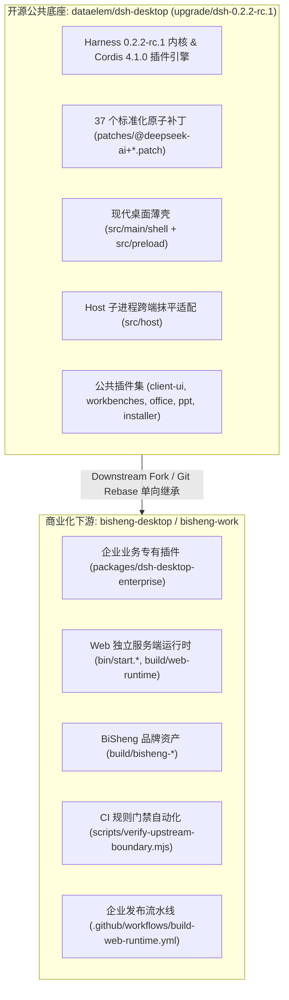
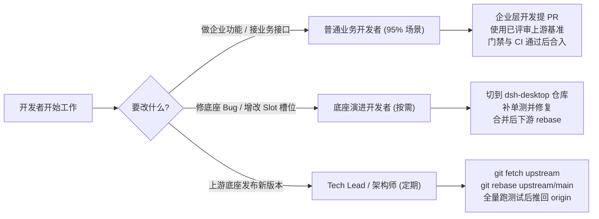

# BiSheng Desktop / Work 下游分层架构与开发规范指南

本文档规定 BiSheng 商业版（`bisheng-desktop` / `bisheng-work`）与开源公共底座（`dataelem/dsh-desktop`）之间的工程协同架构、边界规则、开发工作流与质量保障闭环。

---

## 1. 架构定位与职责边界



### 职责边界对照表

| 维度 | 开源底座 `dataelem/dsh-desktop` | 商业版 `bisheng-desktop` (`bisheng-work`) |
| :--- | :--- | :--- |
| **定位** | 通用 AI Agent 跨端宿主与基础运行时平台 | 商业化产品形态、企业级能力集与无头 Web 服务 |
| **核心代码** | `src/main/shell/`、`src/host/`、`src/preload/`、`patches/` | `packages/dsh-desktop-enterprise/`、`build/web-runtime/` |
| **插件体系** | 基础开源插件（支持 Desktop/Web 双模自适应） | 独占企业商业插件（SSO、企业模型、配额积分、敏感词审计） |
| **补丁管理** | 权威维护 37 个标准的 `patch-package` 原子补丁 | 严禁在下游自建单体 `unified.patch`，严禁动态修改 `node_modules` |
| **测试套件** | 290+ 个核心契约单元测试（通过 Mock 插件独立运行） | 继承全部底座测试 + 商业层端到端业务集成测试 |

---

## 2. CI 规则门禁（Boundary Gatekeeper）

为避免因“人不可靠”或工期紧急导致在下游随意篡改底座代码，仓库部署了机械化 CI 门禁（`scripts/verify-upstream-boundary.mjs`）。

### 2.1 白名单目录
下游 PR 与本地提交按门禁脚本的精确规则检查。企业插件、品牌配置、独立 Web 交付与企业流水线属于下游；公共底座先经上游 PR + CI 合入，再同步。主要允许范围如下：

* `packages/dsh-desktop-enterprise/**`（企业专有业务代码）
* Office 的 `lib/web-modes.{js,d.ts}`、`lib/web-runtime.js`、`web-cli.mjs`、`web-index.{js,d.ts}`；工作台的 `web-package-backend.{mjs,d.mts}`、`local-archive.mjs`（精确 Web 适配入口）。
* 工作台旧企业适配文件 `enterprise-install.mjs`、`install-outcome.mjs` 仅允许迁移删除，不允许继续编辑或新增。
* `build/bisheng-*`、`build/app-icon.png`、`build/icon.*`（品牌资源）
* `build/web-runtime/**`、`bin/start.*`（Web 运行时独立配置与脚本）
* `build/dsh-desktop.patch.yml`（仅允许挂载 enterprise 插件）
* `ops/ci/**`、`ops/nginx/work-updates.conf`、`docs/downstream-*.md`；CI workflow 精确允许 `release.yml`、`build-web-runtime.yml`、`verify-boundary.yml`、`bisheng-ci.yml`。
* Web 打包脚本 `pack-{office-web,ppt-web,workbenches-web,web-runtime}.mjs`、`prepare-web-ci-inputs.mjs` 及门禁列出的构建/验证/启动辅助脚本；不按 `scripts/web-*` 前缀任意放行。
* `test/enterprise-*`、`test/web-runtime-*` 的脚本与 fixture、门禁自身、package/锁文件、品牌及构建配置，具体扩展名与路径以脚本列表为准。

### 2.2 机械阻断原则
对 `src/main/`、`src/host/`、`src/preload/`、`patches/` 等公共底座的下游漂移，本地 `npm run verify:boundary` 与 GitHub Actions 均阻断。`patches/` 没有目录白名单。只有最终文件字节、Git 文件模式和对象类型与已评审上游基准完全一致的核心同步才通过；暂存区有差异时也须与该基准一致，不能用恢复工作区来隐藏待提交的底座修改。

基准取显式 `UPSTREAM_BASE`，未指定时只使用已验证的 `upstream/bisheng-adaptor`。所有 Git 调用使用 `execFileSync` 参数数组，无 shell 插值。基准不存在、不是 commit 或无法求 merge-base 时直接失败；禁止回退到 `origin/main`、`main` 或 `HEAD~1`。CI 应先获取已评审 ref，或显式传入已评审的上游 commit。维护者负责评审来源，脚本负责解析与内容核验。

比较包含基准与 HEAD 的双点差异、暂存区和工作区差异，并通过 `git ls-files --others --exclude-standard -z` 逐文件收集未跟踪源文件。所有文件列表采用 NUL 分隔，保留空格、换行与 tab。未同步的上游底座更新同样会失败，须先同步再运行最终门禁。仅未跟踪的确切 `.tmp/` 路径可忽略；tracked/staged 的 `.tmp/` 变更一律失败，`.tmp-secret` 等相似前缀不享有例外。忽略规则中的 node_modules 和临时缓存不会纳入未跟踪列表。

回归使用临时真实 Git 仓库：`node --test test/enterprise-boundary-gate.test.mjs`（Node 24 普通执行，无 Electron 或实验 VM 参数）。

---

## 3. 开发者工作流分类指引



### 角色 1：普通业务开发者（95% 研发场景，零心智负担）
* **日常体感**：与普通的单仓库开发完全一致。
* **基准准备**：开发环境或 CI 必须提供可验证的已评审上游基准（默认 `upstream/bisheng-adaptor`，也可显式设置 `UPSTREAM_BASE` 为已获取的上游 commit）；基准缺失会失败，不使用 origin 分支兜底。
* **操作流程**：
  ```bash
  git clone https://github.com/dataelement/bisheng-desktop.git
  git checkout -b feat/user-quota-ui
  # 专注在 packages/dsh-desktop-enterprise/ 下编写代码
  npm run verify:boundary # 验证门禁放行
  git commit -m "feat: 新增企业用量预警提示"
  git push origin feat/user-quota-ui
  # 提 PR，CI 自动验证通过合入
  ```

### 角色 2：底座演进与底层 Bug 修复者（严谨闭环）
* 当发现底层 Host 异常、Windows 路径 Bug、或者需要新增前端 Slot 时：
  1. 打开 `dataelem/dsh-desktop` 仓库；
  2. 编写一个测试用例（使用通用 Mock 插件复现问题，测试标红 ❌）；
  3. 修改底座代码，使单测变绿 ✅；
  4. 运行 `npm test` 保证底座全量单测通过，推送到上游分支合并；
  5. 下游通过 `git fetch upstream && git rebase` 引入更新，下游业务立刻自愈。

### 角色 3：Tech Lead / 架构师（版本迭代同步）
* 当底座发布大版本时（例如 `0.2.3`）：
  ```bash
  git fetch upstream
  git rebase upstream/upgrade/dsh-0.2.3
  npm run verify:boundary
  npm test
  git push origin main
  ```
  其他所有团队成员只需一次简单的 `git pull` 即可同步升级，无任何痛点。

---

## 4. 双运行形态（Dual-Target Runtime）

应用支持在同一个代码库下构建桌面客户端与服务端 Web 镜像：

```bash
# ================= 桌面端 (Desktop Electron) =================
npm run dev                  # 桌面端本地热重载调试
npm run build                # 桌面端生产编译
npm run package:mac          # 打包 macOS 桌面应用 (.dmg / .zip)
npm run package:win          # 打包 Windows 桌面安装包 (.exe)

# ================= 服务端 (Headless Web Server) =============
npm run web:start            # 本地直接启动 Web 服务 (端口 3080)
npm run web:pack             # 一键打出包含 Node 绿色环境的 Web 独立运行包
```

---

## 5. 质量保证与交付检查清单

提交前必须依次执行以下检查命令，确保通过后方可交付：

```bash
npm run verify:boundary      # 1. 门禁检查: 确保未非法越界改动底座文件
npm run typecheck            # 2. 类型检查: TypeScript 严格类型无报错
npm test                     # 3. 契约回归: 底座 290+ 个单元测试 100% 通过
npm run web:pack             # 4. 运行时验证: Web 独立运行包组装成功
git diff --check             # 5. Git 格式检查: 无空格与符号残留
```
