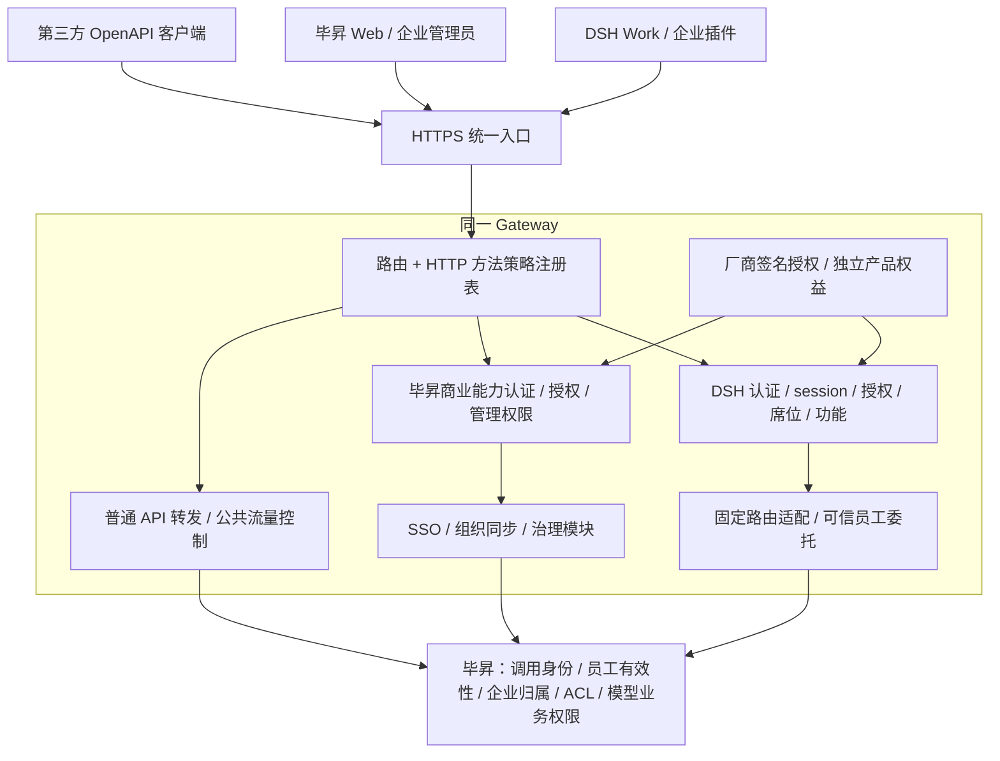

# Gateway 商业版整体架构：DSH 与毕昇

修订：2026-10-19。状态：架构提案，尚未实现或部署。

本方案延续 DSH 商业准入统一收敛到 Gateway 的决定，同时覆盖毕昇商业版。它补充 [架构评审页](design/bisheng-work-gateway-1.6.0.html)；与早期知识接入草案冲突时，以本文的整体边界为准。

## 1. 总体决策

采用一个 Gateway、共享商业授权底座、独立产品权益。首期在现有 Spring Cloud Gateway 内按模块实现，复用 SQL、Redis 和现有认证服务，不另建授权微服务或新的 Agent runtime。

- DSH 商业版：统一控制企业登录会话、企业授权、当前用户有效 Work 席位、操作功能权限。
- 毕昇商业版：控制 SSO、组织同步、治理等商业能力；不默认要求 Work 席位。若未来售卖毕昇席位，单独定义产品席位池。
- 毕昇基础能力：沿用 Web / OpenAPI 身份、scope、企业隔离及资源 ACL，不因 DSH 到期或撤席而停用。
- 产品可独立购买、组合购买。DSH 访问毕昇知识能力要求 DSH 对应功能权益与毕昇业务权限；不隐含要求购买另一套毕昇商业包。确有跨产品购买前置条件时，必须在产品政策中显式声明。



## 2. 三条请求通道

| 通道 | 入口与用途 | Gateway 决策 | 后续处理 |
| --- | --- | --- | --- |
| DSH | 目标 `/api/dsh/**`；兼容 `/api/v1/dsh/**` | 按认证类别校验；业务执行完整 DSH 准入 | 固定映射到毕昇模型、工具、知识等接口 |
| 毕昇商业能力 | 现有 SSO、组织、治理及对应代理端点，逐项登记 | 对应商业功能授权、用户或服务认证、管理权限 | Gateway 本地模块或受控毕昇接口 |
| 毕昇普通业务 | 已有 `/api/v1/**`、`/api/v2/**` 等，排除上述路由 | 公共安全和流量控制；保持原有业务认证归属 | 毕昇校验 Web / OpenAPI 凭据、scope 和 ACL |

内部服务、登录回调、健康检查、授权导入与恢复属于独立控制策略，不归为匿名业务透传。SSO 回调使用 state、票据和回调约束；不要求尚未建立的登录态。

一个请求可以同时带有普通业务认证要求和附加商业功能策略，例如调用某个付费治理操作。付费能力即使位于 `/api/v2/**` 或换了别名，也须登记；不能通过“所有 v2 都免费”或“所有非 v2 都收费”判断。

商业扩展若同时有 Gateway 和后端两个入口，两端都必须拒绝未经授权的调用。可在毕昇的统一商业路由依赖层验证 Gateway 准入证明，避免每个业务函数自行回调。

## 3. Gateway 内部模块与数据归属

| 模块 | 职责 | 权威状态 |
| --- | --- | --- |
| RoutePolicyRegistry | 路径模板、方法、认证方式、产品、功能、席位要求、上游、传输类型 | 随代码评审的版本化策略 |
| Authentication | DSH access / refresh、票据兑换、Web 管理员、内部服务分别认证 | DSH session 在 Gateway；员工和 Web 身份在毕昇 |
| Entitlement | 验证厂商签名、产品范围、有效期和功能权益 | 厂商签名文档及受控版本；本地仅保存验证结果 |
| Seat / Session | Work 席位分配、撤销、session 撤销、refresh 轮换 | Gateway 共享 SQL |
| Admission | 组合上述检查，产生本次请求的受信任决策 | 请求内上下文，不接受客户端提供的放行结果 |
| UpstreamAdapter | 路径映射、凭据替换、可信员工委托、流式代理 | 服务端配置与密钥存储 |
| CommercialModules | 保留 SSO、组织同步、治理等既有能力 | 各现有模块，不迁移知识业务到 Gateway |
| Audit / Administration | 授权状态、席位、会话、策略版本、拒绝原因及管理操作 | 管理审计；不存 token 和业务正文 |

Gateway 不持有第二份员工权限库或知识 ACL。席位主体使用稳定的 `(tenant_id, user_id)`，不能使用姓名、邮箱或客户端自报企业。商业管理员身份仍由毕昇可信认证确认，管理授权限定租户及操作。

共享 SQL 保存席位、session、refresh token 哈希及撤权版本。Redis 用于服务签名 nonce 去重、限流等；其丢失不能恢复已撤销 session，也不能把席位重新变成有效。数据库故障时相关商业业务拒绝，不能降级为仅验证 JWT。

## 4. 授权模型：一个底座、两个产品域

以下为目标逻辑模型，不是当前 License JSON 或已分配的 bit 编号。

| 授权层 | 典型内容 | 约束 |
| --- | --- | --- |
| 授权主体 | license_id、客户、deployment_id、tenant 绑定、revision、有效期 | 绑定由厂商签名及受控映射确定；不接受请求头指定授权所属企业 |
| `dsh` 产品域 | enabled、seat_limit、模型 / 知识 API / 企业市场功能 | 当前 Work 席位复用；不另建知识席位 |
| `bisheng` 产品域 | SSO、组织同步、治理等功能 | 独立有效期和功能集合；不推导出 Work 席位 |
| 管理层 | 谁可分配席位、导入授权、配置 SSO | 运行时管理权限，不能通过管理操作扩大已购权益 |

功能在策略中使用稳定名称，例如 `dsh.model`、`dsh.knowledge_api`、`bisheng.sso`；底层可以继续使用按产品命名空间隔离的 bitset。功能名与 bit 映射版本化，不能复用已废弃 bit；未知必需功能拒绝。缺少新功能字段的旧授权不自动获得新权益。

企业是否购买功能、调用凭据是否具有 scope、员工是否可访问数据是三次独立判断。购买知识 API 不授予全部知识库；买模型能力不意味着能使用所有模型。

厂商签发采用非对称签名，可延续已有 DSH RS256 验签设施；Gateway 仅持授权验签公钥。旧毕昇 License 的 RSA 外层解密不是厂商签名，需要通过独立 legacy adapter 兼容，逐步补齐毕昇产品域签名。客户环境不得携带厂商授权签发私钥。授权签名密钥、access token 密钥、内部服务密钥、插件包签名密钥分别管理。

签名文档支持离线验签，不要求每次请求连厂商云；每次请求仍验证当前有效期和已生效授权版本。多副本先将验证成功的新版本存入共享权威状态，再按该版本准入；仅本地文件更新或广播不足以保证全副本生效。拒绝回退到已被替代的授权 revision；备份恢复也需恢复版本记录。

完全离线环境无法立即获知厂商远程撤销，只能按已导入状态和到期时间执行。需要厂商在线撤销保证时另加有期限的授权租约；租约过期且无法续期时拒绝对应业务，不能宣称离线文件具备即时远程撤销能力。

## 5. 统一策略与 DSH 准入

注册表至少声明：`route_id`、路径模板、HTTP 方法、认证策略、产品 / 功能、是否需要席位、固定上游与映射、传输类型。控制端点显式写“不适用”，不能把缺字段理解为免检。

| 操作 | 认证策略 | 商业与席位策略 |
| --- | --- | --- |
| 创建登录授权 | state / PKCE challenge、客户端和回调限制、限流 | 允许开始认证；不要求已有 access 或席位 |
| 票据兑换 access | 一次性 identity ticket + PKCE verifier | 确认员工身份，检查 DSH 授权及席位再发 token |
| 刷新 | refresh 哈希、归属、session、轮换与重用检测 | 重新检查当前授权与席位，不要求有效 access |
| 注销 / 自助撤销 | 可确认归属的 access 或 refresh，按端点合同校验 | 授权过期、撤席后仍允许清理；幂等 |
| 模型调用 | 对应用途的 DSH access + 当前 session | DSH 有效授权 + 有效席位 + 模型功能 |
| 知识检索 / 引用 / 上传 | 对应用途的 DSH access + 当前 session | DSH 有效授权 + 有效席位 + 知识 API 功能 |
| 席位 / 授权管理 | 毕昇管理员或限定管理服务身份 | 验证管理权限；不要求管理员先占 Work 席位 |
| 内部 introspect / 服务操作 | 定向服务认证、防重放、操作权限 | 按内部操作声明，不接受普通用户 token 代替 |
| 毕昇商业功能 | Web / 回调 / 服务认证，按操作区分 | 对应毕昇权益；默认不查 Work 席位 |

现有 `/api/dsh/token` 同时承载票据兑换和刷新，可在该精确端点有界解析小请求体的 `grant_type` 后分派。不能为了统一过滤器而读取所有业务正文；也不能在看到未知 grant type 后退回匿名处理。

DSH 业务准入固定为：

```text
规范化路径并匹配 HTTP 方法
  → 策略存在且属于该入口
  → token 签名 / 算法 / issuer / audience / 类型 / 有效期
  → session 当前有效，主体一致
  → 企业产品授权当前有效
  → 当前席位归属、状态与 grant_version 一致
  → 满足该操作全部必需功能
  → 生成请求内准入上下文
  → 可信身份适配后转发
```

DSH 新增路由未登记时拒绝。旧地址、别名、尾斜杠及路径重写不能退回普通透传；拒绝歧义编码、路径分隔符和不支持的方法。规范化、策略匹配和转发必须使用同一路径解释。若一个通用工具端点承载不同商业功能，策略还要绑定已登记工具标识；未知工具拒绝，不能全部借用一个宽松 bit。

以 WebFlux `WebFilter` 覆盖本地 Controller 和代理请求，共享同一 Admission 服务；路由适配层核对最终目标与决策一致。单独增加 Spring Cloud Gateway `GlobalFilter` 无法覆盖本地 Controller。相关 SQL 调用须通过项目既有异步适配或有界工作线程执行，不能阻塞 Reactor 事件线程。

## 6. 可信身份与防旁路

### Work 到 Gateway

Electron 主进程保管和刷新企业凭据，企业插件通过现有 Broker 调用。Broker 继续负责同源、实例生命周期及资源限制；路由商业策略由 Gateway 执行，不在插件中维护第二套商业门禁。SDK 路径和旧客户端需同步迁移，不能仅更改服务器地址。

旧 token 的 audience 是 `bisheng-dsh-model`，新增知识用途必须版本化定义。可以签发面向 Gateway 的新版 DSH token，再按路由检查功能；旧模型 token 仅允许明确的模型兼容策略，不能扩展到知识或普通 v2。

### Gateway 到毕昇

Gateway 清除外来员工 / 企业委托头、伪造准入证明及不可信转发头。DSH 转发时替换桌面 Authorization，从已认证会话生成用户身份；上游地址来自固定策略，不能由客户端指定。不同上游只接受各自凭据。

- 知识等现有 v2 能力：优先复用专用服务账号 Bearer + `delegate` + `X-On-Behalf-Of`。凭据仅在 Gateway，按租户、接口 scope、可委托员工范围收窄。毕昇验证服务账号、委托范围、员工有效性及真实 ACL；不能以服务账号的更高权限替代员工权限。此链路无需再为上传正文叠加 HMAC。
- DSH 专用模型等入口：增加统一可信调用依赖，验证专用 Gateway 服务身份和受保护的员工上下文。建议使用短期、指定 audience 的内部签名凭证，绑定 tenant、user、method、上游规范路径、操作、request_id、过期时间及防重放标识。与桌面 access token 使用不同密钥和用途；签名头不依赖聚合正文，传输完整性由验证证书的 TLS 提供。现有小体积内部控制调用可继续使用有正文摘要和 nonce 的 HMAC。

当前 v2 委托实现明确拒绝全局 / 租户管理员作为目标用户。因此这条适配目前不能承诺覆盖所有 Work 账号。首期应明确不支持该类目标用户，或先新增经评审的“以管理员的普通员工权限执行”的受限身份合同；不能直接移除保护、使用普通员工冒充管理员或回退到服务账号权限。

部署时，外部 `/api/dsh/**`、`/api/v1/dsh/**` 及旧商业别名先进入 Gateway；毕昇 DSH 源站不暴露公网，业务依赖也独立拒绝未认证 Gateway 调用。内部管理与 introspect 仅开放服务网络和对应服务认证。源站隔离、受保护身份及普通 v2 拒绝 DSH token 三项共同验收。

普通 v2 继续接受其合法 Web / OpenAPI 凭据，不要求 Work 席位。用户另行获准的独立集成属于正常 v2 授权，不能仅凭“看起来像 Work”识别并阻断；防旁路保证针对 DSH 凭据及 Gateway 专用委托凭据，后者不得下发给 Work。

## 7. 毕昇商业能力的生命周期

| 场景 | DSH 行为 | 毕昇行为 |
| --- | --- | --- |
| 仅购买 DSH | 按 DSH 功能与席位使用 | 基础能力继续可用，毕昇付费扩展按购买情况判断 |
| 仅购买毕昇商业版 | 不推导 DSH 权益 | SSO、组织、治理按已购功能工作 |
| DSH 撤席 / 到期 | 拒绝后续相关业务 | 不影响正常毕昇登录会话和普通 API |
| 毕昇某功能到期 | DSH 仅在明确依赖该功能时受影响 | 停用对应付费能力，不删除用户、知识、文件或流程 |
| 两类授权都无效 | 拒绝 DSH 商业业务 | 保留基础能力、恢复入口及受认证的授权管理 |

停用 SSO 后必须保留受保护的本地管理员登录和授权修复路径；不能放开匿名管理或删除同步来的员工。已存在 Web 会话是否继续有效由会话安全策略决定，不等于 Work session。

组织同步的启停不能把组织关系重置为空。治理过滤器应区分可选商业附加能力与管理员要求强制执行的安全控制；授权失效时，强制控制不可通过“跳过过滤器”静默放行受保护操作，应拒绝并告警。基础身份认证、企业隔离和 ACL 始终执行。

## 8. 撤权一致性、流式与故障策略

首期每次 DSH 业务准入读取共享 SQL 中已提交的 session / seat / grant_version；不使用跨请求正向授权 TTL 缓存。一个请求内采用一致的状态快照；撤席及关联 session 失效在事务中提交。分配 / 重分配需要租户容量锁或等价并发控制及唯一约束，避免多副本超发。

定义“立即撤权”为：撤销事务成功后开始准入的新请求必然被拒绝。已完成准入的请求属于在途请求，允许按既定超时结束；即使还未返回响应头也不能宣称它是撤权后的新请求。后续若加入缓存，必须先定义并验证新的撤权时限，不能只依赖广播或 JWT 到期。

| 依赖或状态 | 策略 |
| --- | --- |
| token / session 无效 | 401，返回稳定认证错误码 |
| 授权、席位、功能拒绝 | 403，明确区分原因 |
| 授权状态或 session / seat 权威存储不可用 | 503，相关商业业务拒绝；不伪装成未购买 |
| 未登记的受管路由 | 默认拒绝，不转发；按合同返回 404 / 405 并记录策略缺失 |
| Redis 防重放或必要限流不可用 | 对需要该能力的操作拒绝；不得跳过安全校验 |
| 上游身份认证或 ACL 不可用 | 保留上游拒绝 / 故障语义，不改用管理员执行 |

旧商业接口可能使用 HTTP 200 + 业务错误码，迁移时由显式兼容适配处理；新版 DSH 使用真实 HTTP 状态和稳定 `code` / `request_id`，不一次性改变旧 Web 合同。

SSE、文件上传、下载、WebSocket 握手在读取业务正文前完成准入，之后按背压转发。DSH 流式和上传路由不能继承通用 `CacheRequestBody:String`；配置独立的体积、连接数、空闲与总时长限制。客户端现有 Broker 有自身大小 / 时长上限，大文件上传还需单独完成传输合同，不因网关支持流式就宣称客户端已支持。

首期撤席阻断新请求，已建立长连接按有界时长结束；如需强制断开，再增加连接登记、撤销事件及周期复核，并验证多副本送达。异步任务执行不是原 HTTP 长连接：首期允许已接收任务在既定范围内完成，后续查状态、下载结果仍重新鉴权；任务内部新增用户操作须再次准入。不能将任意后续动作永久继承为已授权。

审计记录 route_id、策略 / 授权版本、tenant / user、session、席位版本、功能、决策原因、request_id、状态和耗时。对有用户委托的调用，同时记录真实调用服务和生效用户。禁止记录凭据、完整查询参数、请求正文和文档内容；流开始后的失败不能改写成 JSON 成功响应。

## 9. 管理体验与实施顺序

在毕昇现有管理端增加统一授权视图，分别展示“毕昇商业能力”和“DSH 授权 / 功能 / 席位”。用户、组织和资源权限沿用毕昇；席位和 session 管理由 Gateway 承载。状态查询也需区分公开最小状态与仅管理员可见的授权、租户和会话详情。

1. 盘点入口：反向代理、Gateway Controller / 代理路由、毕昇 DSH 及商业别名、客户端请求，形成路由策略表与覆盖测试。
2. 建立共享授权投影和 Admission 模块；接入全部 DSH 新旧入口，保留毕昇现有商业合同与基础通道。
3. 增加可信上游身份及源站隔离，测试直连、伪造头、普通 v2 使用 DSH token 等旁路路径。
4. 在全部业务经过统一准入且旁路封堵验收后，移除毕昇基础席位 introspect 依赖；保留内部核验端点。回退版本也必须保留至少一条有效准入链，不能双端同时关闭。
5. 接入知识 API 功能与 v2 委托，解决管理员委托合同；分别验证检索、引用，再扩展上传。
6. 迁移毕昇商业端点的逐功能策略及签名授权；完成授权到期、SSO 恢复、多副本撤权和真实 Work 流式验收。

每阶段都须验证：两产品授权独立、DSH 新旧入口一致、未知方法 / 路由拒绝、session / 席位撤销跨副本生效、缺 bit 拒绝、跨企业 / 越权资源拒绝、授权依赖故障拒绝、登录 / 刷新 / 注销 / 管理分级认证，以及商业到期后基础与恢复能力仍可用。不能仅以 JWT 验签通过、单接口 200 或源码测试替代整条链路验收。

## 10. 本次源码核对与未验证范围

2026-10-19 静态核对 Gateway `main@a258b2cf`、毕昇 `a00eecf85` 及当前 Work 分支；没有修改或探测生产环境。

- [Gateway DshRoutes](../../bisheng-gateway/src/main/java/com/dataelem/gateway/dsh/config/DshRoutes.java)：现有路径归属清单不是按方法和功能声明的完整准入策略表。
- [Gateway DshIntrospectionService](../../bisheng-gateway/src/main/java/com/dataelem/gateway/dsh/service/DshIntrospectionService.java)：已有授权、席位 / grant_version 和 session 核验，可复用底层判断。
- [Gateway LicenseExpiredGlobalFilter](../../bisheng-gateway/src/main/java/com/dataelem/gateway/filter/LicenseExpiredGlobalFilter.java)：实际为 WebFilter；保留普通版本业务，商业端点仍含按路径归类逻辑，需要显式策略替代。
- [Gateway DshEntitlementService](../../bisheng-gateway/src/main/java/com/dataelem/gateway/dsh/service/DshEntitlementService.java)：当前严格 schema v2 仅声明 DSH enabled / seat_limit；新产品或功能字段需要版本化迁移。
- [毕昇 DshAccessService](../../bisheng/src/backend/bisheng/dsh/domain/services/access.py)：当前仍验证旧模型 token 并回调 Gateway introspect，本方案提出的统一前置准入尚未替代它。
- [毕昇 v2 身份依赖](../../bisheng/src/backend/bisheng/open_api/api/dependencies.py) 与 [委托校验](../../bisheng/src/backend/bisheng/open_api/domain/services/identity_service.py)：已有统一凭据 / scope、员工委托和租户校验；管理员目标限制仍须处理。
- [Work 企业通道](enterprise-auth-channel.zh.md)：已有主进程凭据、实例授权及流式资源限制，不能当作商业准入或恶意插件沙箱。

本次仅交付设计文档并检查链接与差异；未实现统一过滤器、新授权 schema、源站可信身份迁移，未执行运行时、安装包、Windows 或生产验收。文中的新模块名、功能名和新版合同均为提议。
